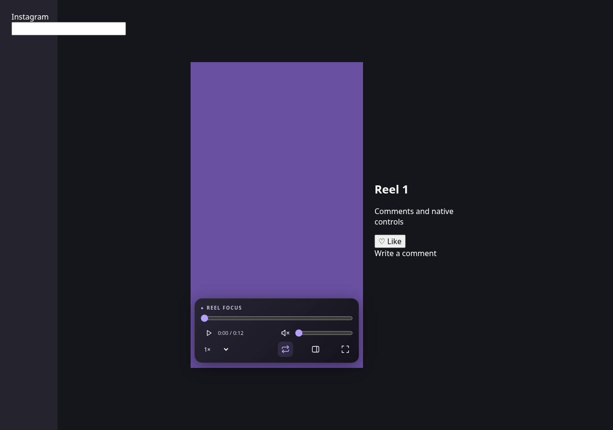

# Reel Focus

**Better playback controls and distraction-free viewing for Instagram Reels.**

[](https://github.com/PranavP2207/Reel-Focus/releases/latest)
[](https://github.com/PranavP2207/Reel-Focus/actions/workflows/release.yml)


Reel Focus adds seeking, volume, playback speed, looping, fullscreen, and a distraction-free focus mode to Instagram's Reels feed, direct reel pages, and video dialogs opened from Saved. Everything runs locally in the page with vanilla JavaScript and CSS.

**[Download v1.1.1](https://github.com/PranavP2207/Reel-Focus/releases/download/v1.1.1/reel-focus-1.1.1.zip)** · [Release notes](RELEASE.md) · [Report a bug](https://github.com/PranavP2207/Reel-Focus/issues/new) · [Request a feature](https://github.com/PranavP2207/Reel-Focus/issues/new)

No build step, runtime dependencies, background service worker, tracking, or video downloading. Desktop Chrome, Edge, Brave, Opera, and Vivaldi are the target browsers.

## Contents

- [Preview](#preview)
- [Features](#features)
- [Getting started](#getting-started)
- [Usage](#usage)
- [Keyboard shortcuts](#keyboard-shortcuts)
- [Compatibility and limitations](#compatibility-and-limitations)
- [Privacy and permissions](#privacy-and-permissions)
- [Troubleshooting](#troubleshooting)
- [Development](#development)
- [Contributing](#contributing)
- [Support and maintainer](#support-and-maintainer)
- [License](#license)

## Preview



*Preview from the offline browser test fixture using a generated video.*

## Features

| Feature | What it does |
| --- | --- |
| Playback controls | Play/pause, seek with elapsed time and duration, volume, and mute. |
| Playback speed | Choose 0.5×, 1×, 1.25×, 1.5×, or 2×. |
| Loop toggle | Turn repeat playback on or off. |
| Rotation | Rotate only the video left/right in 90° steps, fit it without cropping, or reset with `0`. Rotation resets for each reel. |
| Wrapper fullscreen | Keep the video and custom controls together in fullscreen; use Up/Down to navigate reels. |
| Focus mode | Hide comments and surrounding UI, center the reel, and restore the layout with one toggle. Works inside and outside fullscreen. |
| Active reel detection | Follow the visible reel as you scroll or open a video dialog from Saved. |
| Hide controls | Hide the panel instantly with the double-down button or H; restore it with H or the small bottom handle. |
| Local preferences | Remember volume, mute, speed, loop, and focus state in your browser profile. |

The overlay adapts to portrait reels with a two-row layout that keeps every control available.

## Getting started

No Node.js, npm, or build tools are needed to use the extension.

1. [Download the installable v1.1.1 ZIP](https://github.com/PranavP2207/Reel-Focus/releases/download/v1.1.1/reel-focus-1.1.1.zip) from the release's **Assets** and extract it. Alternatively, choose **Code → Download ZIP** for the complete source, or clone the repository:

   ```sh
   git clone https://github.com/PranavP2207/Reel-Focus.git
   cd Reel-Focus
   ```

2. Open your browser's extensions manager:

   | Browser | Address |
   | --- | --- |
   | Chrome | `chrome://extensions` |
   | Edge | `edge://extensions` |
   | Brave | `brave://extensions` |
   | Opera | `opera://extensions` |
   | Vivaldi | `vivaldi://extensions` |

3. Enable **Developer mode**, choose **Load unpacked**, and select the extracted or cloned folder containing `manifest.json`.
4. Refresh any Instagram tabs that were already open. Open the [Reels feed](https://www.instagram.com/reels/), a `/reel/<id>/` page, or a reel from Saved.

**Updating:** Download or pull the latest source, click **Reload** on the extension's card in the extensions manager, then refresh Instagram.

## Usage

Move the pointer over the reel to reveal the controls. They fade after 2.5 seconds of inactivity and remain visible while hovered or keyboard focused. The seek bar becomes available once Instagram supplies a finite duration. The volume slider also unmutes; dragging it to zero mutes.

Click **Hide controls (H)** next to the rotate buttons or press **H** for sticky hiding. Mouse movement, focus, playback events, and reel changes keep the panel hidden in normal view, focus mode, fullscreen, and rotated viewing. Press **H** again or click the small up-chevron handle centered at the viewport's bottom edge to show it. The handle dims to 20% after 2.5 seconds; moving within the bottom 80px brightens it. A thin, non-interactive progress line and all playback shortcuts remain available while hidden. This state is temporary: refreshing the page starts with the panel visible.

Click fullscreen or press **F**. The extension fullscreens the existing main/dialog container, which contains both Instagram's video and the extension's controls. It never moves or clones the video. Click fullscreen again, press **F**, or press **Esc** to leave.

Click the split-panel icon or press **C** for focus mode. The video fills the viewport with its aspect ratio preserved; comments and surrounding UI are hidden. Toggle again to restore them. This works independently of fullscreen. The last focus setting follows you to the next reel.

Switching to another tab pauses playback. Returning resumes only a reel that was automatically paused; a reel you paused with the controls, Space/K, or a video click stays paused even if Instagram calls `play()`. Pause state resets when a new reel becomes active.

Use the rotate buttons or **[ / ]** to turn a landscape reel in 90° steps. **0** resets its orientation. Only the video rotates; fitting updates on resize, fullscreen changes, and focus toggles. Rotation is not saved and resets when the active reel changes.

## Keyboard shortcuts

| Key | Action |
| --- | --- |
| Space / K | Play or pause |
| M | Mute or unmute |
| F | Enter or exit fullscreen |
| Esc | Exit fullscreen |
| C | Toggle focus / restore comments |
| H | Hide / show controls (sticky until revealed or the page reloads) |
| L | Toggle looping |
| Left / Right | Seek backward / forward 5 seconds |
| Up / Down | Previous / next reel, including in fullscreen |
| `<` / `>` | Slower / faster: 0.5×, 1×, 1.25×, 1.5×, 2× |
| `[` / `]` | Rotate video left / right by 90° |
| `0` | Reset rotation |

Up/Down is reserved for reel navigation; use the slider for volume. Navigation first uses Instagram's next/previous controls, including ARIA labels and SVG titles. It then uses another loaded reel; dialogs fall back to one ArrowLeft/ArrowRight event, while the feed falls back to scrolling. A missing previous item leaves the dialog alone. On most keyboard layouts, `<` and `>` require Shift.

Shortcuts are ignored in inputs, textareas, selects, contenteditable regions, and ARIA textboxes. The controls retain normal range/select keyboard operation. Space on a focused button activates that button. Ctrl, Alt, and Meta combinations pass through. Handled shortcuts are stopped so Instagram does not perform the same action a second time; native like/comment/share clicks outside the extension pass through.

## Compatibility and limitations

- Instagram changes its markup frequently and runs layout experiments. The adapter may need adjustment; the extension safely detaches when no suitable video is visible. Test the feed, a direct reel, and Saved on your own account.
- Saved video dialogs are treated as reels even when Instagram keeps a Saved or `/p/` URL. This may also enable the controls on an ordinary video post opened in a dialog. Saved grid thumbnails alone are not activated.
- Next/previous navigation needs Instagram's native navigation button, a loaded neighboring reel, or a scrollable feed. Localized button labels can be added to the `nextLabels`/`previousLabels` arrays in `CONFIG`. The dialog keyboard fallback may be ignored if Instagram requires trusted events. The extension does not fetch or preload reels itself.
- Fullscreen requires a real click or keypress. Browser policy may refuse it. Content Instagram portals outside the fullscreen wrapper will not be visible there; exit fullscreen to interact with it.
- Focus hides Instagram's close/comment/share UI along with the comments; press C to restore it. While a reel is focused, wheel scrolling over the fixed video can be intercepted by Instagram; Up/Down provides explicit navigation.
- Live streams or media with no finite duration cannot be sought. Instagram may reset playback properties when replacing its player. Audible autoplay may use temporary mute until a real click/key; browser policy can still require a Play click if all autoplay is denied. Failed playback/fullscreen requests are ignored safely.
- Desktop Chromium browsers are targeted. Safari, Firefox, mobile browsers without desktop extension support, and Instagram's native apps are outside scope. Fixture testing uses Chromium; other browsers have not been manually verified.

## Privacy and permissions

- The only extension permission is `storage`; injection is limited to `https://www.instagram.com/*`.
- No analytics, tracking, remote code, or network requests from the extension.
- No downloading, scraping, saving, or transmitting Instagram content.
- No background service worker, broad host permissions, tabs permission, or web-request access.

Volume, mute, speed, loop, and focus are stored together in `chrome.storage.local` under `reelFocusPreferences`. A fresh install defaults to **unmuted, volume 1.0**; an existing saved mute preference is respected. Sound changes are saved only from the extension's controls/shortcuts or a real click on Instagram's native audio control. Instagram's programmatic mute/volume resets are reverted instead of saved. If audible autoplay is denied, playback temporarily falls back to muted and unmutes on the first real page click/key; the temporary mute is never saved. Rotation and pause intent are not persisted. Preferences remain in the browser profile and are not synced or transmitted.

## Troubleshooting

| Problem | What to check |
| --- | --- |
| Controls do not appear | Enable the extension, refresh Instagram, and open a supported reel view on `www.instagram.com`. Select the folder containing `manifest.json` when loading unpacked. If it persists, report the affected layout. |
| Comments or native action buttons disappeared | Press **C** or toggle focus off to restore Instagram's surrounding UI. |
| Seek bar is disabled | Wait for video metadata. Media without a finite duration cannot be sought. |
| Fullscreen does not open | Use a real button click or **F** keypress. Browser or organization policy may refuse fullscreen. |
| A downloaded ZIP will not install directly | Extract the named extension ZIP first, then use **Developer mode → Load unpacked** on the extracted folder. |

## Development

Editing `content.js` or `content.css` requires no compilation. Reload the extension in your extensions manager, then refresh Instagram.

Syntax checks require Node.js:

```sh
node --check content.js
node --check tests/browser.cjs
```

`node --check content.js` checks syntax. `node tests/browser.cjs` loads the unpacked extension in Chromium using intercepted, offline Instagram-shaped fixtures. If administrator policy blocks unpacked installation, the harness reports that restriction and exercises the same local content script and CSS with a minimal `chrome.storage.local` adapter backed by fixture-local storage. It does not change browser policy. That fallback verifies page behavior and persistence logic, but does not verify extension installation, isolated-world execution, or the native Chrome storage API.

For development tests only, Playwright must be resolvable by Node and a recent Chromium with `Extensions.loadUnpacked` support must be installed; set `CHROMIUM_PATH` if it is not `/usr/bin/chromium`. These are not runtime dependencies. The test profile is temporary and is deleted afterward.

If Playwright is not already available, install the development tools locally:

```sh
npm install --no-save --package-lock=false playwright
npx playwright install chromium
```

Then run `node tests/browser.cjs` with a Linux Chromium installation at `/usr/bin/chromium`, or set the executable path. For example, on a POSIX shell using Playwright's Chromium:

```sh
CHROMIUM_PATH="$(node -p 'require("playwright").chromium.executablePath()')" node tests/browser.cjs
```

The browser checks cover playback, seeking, settings, user-vs-automatic tab pause, blocked site auto-resume, preference-wins mute/volume, native mute clicks, muted autoplay recovery, rotation fitting/reset, typing guards, event isolation, wrapper fullscreen, focus continuity, Saved previous-button/keyboard fallback, persistence across reloads, auto-hide, sticky hiding across reels, both reveal actions, handle dimming/placement, hidden-panel shortcuts and video clicks, progress-only updates while hidden, SPA routes, and lifecycle cleanup. Fixtures use a generated video and do not contact Instagram. This environment used the administrator-policy fallback. A manual installation check against your logged-in Instagram layout is still needed.

<details>
<summary>Project structure</summary>

```text
Reel-Focus/
├── .github/workflows/release.yml # Publishes complete GitHub releases
├── manifest.json
├── content.js              # Page adapter, isolated controls, playback and lifecycle
├── content.css             # Reversible focus/fullscreen rules
├── icons/
│   ├── icon16.png
│   ├── icon32.png
│   ├── icon48.png
│   └── icon128.png
├── README.md
├── RELEASE.md              # Complete versioned release notes
├── docs/
│   └── preview.png         # Screenshot of the generated offline fixture
├── packages/
│   ├── reel-focus-1.1.1.zip
│   └── reel-focus-1.1.1.zip.sha256
└── tests/                  # Development only
    ├── browser.cjs
    └── fixture.webm        # Generated solid-color test video
```

The four PNG icons are generated local artwork and are already included; no icon tooling is needed to install.

</details>

<details>
<summary>Maintaining the Instagram layout adapter</summary>

All Instagram selectors and layout heuristics are in the clearly labeled `CONFIG` object at the top of `content.js`. No Instagram class names are used.

| Config entry | Adjust when |
| --- | --- |
| `selectors.videos`, `frame(video)` | The video or its immediate media container changes. The frame provides a stable visibility/scrolling anchor during focus. |
| `selectors.dialogs`, `selectors.main`, `scope(video)` | Saved dialogs or the main reel wrapper change. The scope must contain the video and remain mounted while navigating. |
| `reelRoute`, `eligible(video)` | Reel URLs or Saved overlay presentation change. |
| `selectors.hidden`, `minArea`, `minVisibleRatio` | Instagram changes hidden/preloaded video handling. |
| `selectors.labeled`, `selectors.clickable`, `nextLabels`, `previousLabels`, `navigationRegion(scope)` | Native navigation labels change, particularly in another language. |
| `selectors.typing` | Instagram introduces a different kind of text editor. |

One debounced MutationObserver discovers and prunes videos; one IntersectionObserver tracks their media frames, including clipping by nested scroll containers. Visible area and a small preference for the current reel choose the active video, with dialogs taking priority. Scroll/resize events schedule checks without polling. The observer checks the URL cheaply, and `popstate` handles back/forward navigation.

Set `CONFIG.debug = true` temporarily to log which navigation path was used and why a dialog button was not found. It is off by default.

The controls live in a Shadow DOM. Focus uses removable `data-rc-*` attributes and the `rc-focus` class on `<html>` to hide sibling branches along the active video's ancestor path. Visibility preserves the original feed layout, and the video's slot is reserved while it is centered. No comments, media nodes, or Instagram handlers are removed. Active-video listeners are aborted on switching; observers, listeners, timers, animation frames, and focus markers are cleaned up on page exit and restored after a back-forward cache return. During playback, animation frames update the seek bar only while the panel is visible; while hidden, only the thin progress line updates. No progress frames run while paused or in a background tab. The reveal handle shares the existing Shadow DOM and fullscreen wrapper; its 36×14px button is the only clickable area left by manual hiding.

</details>

<details>
<summary>Publishing releases</summary>

`.github/workflows/release.yml` publishes a GitHub release for an existing version tag. It runs when a `v*` tag is pushed or through **Actions → Publish extension release → Run workflow**.

The workflow checks the tagged ZIP against its SHA-256 file and tagged source, confirms the manifest and release-note versions match, and attaches the installable ZIP, checksum, and complete `RELEASE.md` to the release. It uses GitHub's repository-scoped `GITHUB_TOKEN` with `contents: write`; no personal token or extra repository secret is needed. Existing tags are preserved.

For a future version, update the manifest and release notes, commit the matching versioned ZIP/checksum under `packages/`, then create and push the corresponding `vX.Y.Z` tag. The ZIP must contain the source files from that tag. Never replace the files or move the tag for an already published version.

</details>

## Contributing

Bug reports, documentation improvements, layout fixes, translations of navigation labels, and manual browser verification are welcome.

1. Check [existing issues](https://github.com/PranavP2207/Reel-Focus/issues) before reporting a problem or proposing a change.
2. For substantial changes, open an issue describing the problem and proposed behavior first.
3. Fork the repository and create a branch for your change. Keep the change focused and put Instagram selectors/heuristics in `CONFIG`.
4. Run the syntax checks and relevant browser checks above. For playback or layout changes, manually check the feed, a direct reel, and a Saved dialog; include typing, focus restoration, and fullscreen navigation.
5. Open a pull request describing the change, how it was checked, and any remaining limitations. Include a screenshot or short recording when the UI changes.

Preserve the project's scope: playback controls and reversible UI changes, storage-only permissions, local settings, and no content extraction, video downloading, tracking, or extension network traffic. Keep discussion respectful and avoid including private account information in reports.

## Support and maintainer

Maintained in the [Reel Focus](https://github.com/PranavP2207/Reel-Focus) repository by [@PranavP2207](https://github.com/PranavP2207).

For help, [open an issue](https://github.com/PranavP2207/Reel-Focus/issues/new) with:

- Your browser and version, operating system, and extension version.
- The affected view: Reels feed, direct reel, or Saved dialog.
- Steps to reproduce, expected behavior, and what happened instead.
- A screenshot or recording when useful, with private information removed.

For downloads and changes, see [GitHub Releases](https://github.com/PranavP2207/Reel-Focus/releases) and [RELEASE.md](RELEASE.md). Installation and usage do not require a GitHub account.

## License

This repository does not currently declare a license. No `LICENSE` file has been added.
